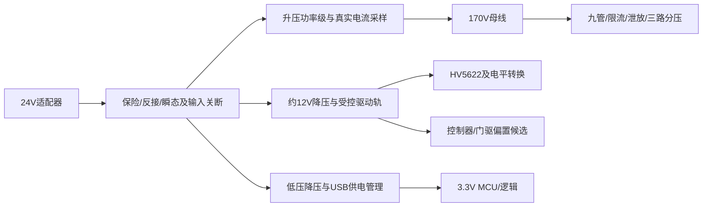
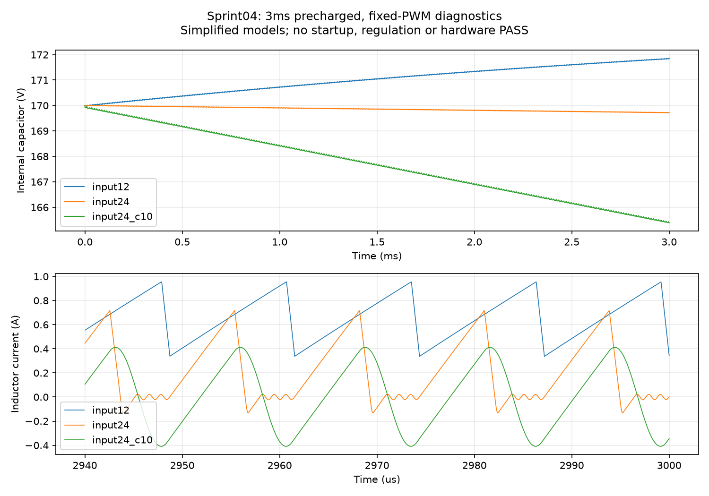

# Sprint 04 — 九管功率、24V输入及方案推演

日期：2026-11-14（Asia/Shanghai）。用户已授权开展Sprint04、研究24V输入并双agent并行。本轮完成两项独立研究、七次ngspice短诊断及证据完整性检查。**整机仍FAIL/HOLD；HV-G0/G1 BLOCKED，HV-G2 FAIL。推荐24V单级升压作为下一阶段主研究候选，尚未批准正式改图或采购。**

## 1. 结论及修正

1. 九管正常静态显示是九个阳极支路，每管一个数字导通，不能按90路各3mA计算。170V母线下九管支路典型3.4425W、3mA/管上限工作点4.590W；加四支泄放及三路分压后分别为**4.0776W、5.2251W**。这是高压侧负载，不是九只灯管自身耗散，也不是适配器总功率。历史Sprint03遗漏ADC分压，本轮补入约19.08mW@170V；保留历史原文。
2. 24V方案在功率规模与转换比上可行，且显著改善控制时序空间。其实现必须包含24→约12V驱动/控制支路、24→3.3V逻辑支路及24→170V高压支路。现有HV5622不能用3.3V或24V替代其约12V供电。保留USB时，5V供电路径也需明确处理。
3. **24V、220µH、78kHz下九管正常负载为理想DCM研究点。** 85.88%是CCM转换比参考，实际满载理想固定PWM解约51.71%；把86%直接用于现有220µH会错误估计功率。电感应与工作模式、峰流、损耗和控制器最小脉宽共同选择，不为获得CCM任意增大。
4. 换24V不会修正原SW→CS错误采样、C10跨整流二极管的能量负担、无限流锁存、安全复位、短路输入通路或泄放单故障。既有失败继续保留。

详细证据：[功率核查](POWER_BUDGET_9TUBE.md)、[24V方案与官方来源](INPUT_24V_FEASIBILITY.md)、[计算数据](topology24_calculations.json)。

## 2. 方案比较与建议架构

|方案|优点|主要代价与约束|本轮处置|
|---|---|---|---|
|保留12V→170V单级|维持外部电源与约12V驱动轨|满载CCM需要约93%+占空；最坏控制时序未获保证，CS及保护还需重做|保留对照基线|
|24V→170V单级，加12V/3.3V降压|降低输入平均电流，正常负载DCM可释放PWM时序空间|需新增12V降压；审查输入电容、MOS栅压、控制器偏置、USB供电与前级瞬态；仍需完整电气验证|**优先研究候选**|
|12V→48V→170V两级|若外部只能12V，可降低每级转换比|多一整级高压功率转换，两环、启动及保护复杂，效率为两级乘积|12V必须保留时的备选|
|反激|可按需要实现隔离，变比可降低占空要求|定制磁件、漏感吸收、反馈与绝缘设计；当前没有已确认隔离需求|暂不优先|

建议研究框图（不是已修改的原理图）：

3.3V方案有两条待比较路径：24→3.3V直接降压，或保留24→5V与USB OR→3.3V。直接降压不能直接并接既有USB侧3.3V电源，需明确电源选择与反灌。24→12V→170V会丢失提高升压输入电压的主要收益，不作为推荐高压路径。

## 3. 功率、占空和时间预算

采用170V、220µH、78kHz及三路分压，理想满载电流30.7359mA。根据[TI SLVA061](https://www.ti.com/lit/an/slva061/slva061.pdf)，分别计算CCM/DCM，而非只套CCM转换比。所有输入包络均为研究假设，且电压定义在电感输入端，不是未计线束/保护压降的适配器插口。

24V名义DCM：D≈0.5171，峰流约0.723A，总PWM低电平约6.19µs；其中理想二极管去磁传能约1.09µs，剩余约5.10µs为空闲。**总关断窗口不是全部有效传能时间**。DCM寄生谐振、恢复和控制响应仍需验证。提高输入使平均输入电流下降，但不能声称开关峰流也减半。

170V高压满载、效率假设75%–90%时，24V输入仅HV支路约0.242–0.290A。沿用3.3V/800mA分配、以HV5622手册高速测试电流作为预算例，加低压综合效率80%–90%后，整机输入示例已约9.34–10.94W，仍未计齐其他辅助和启动。该示例不是电源定额或实测功耗，不据此冻结适配器。

## 4. 本轮实际执行的短仿真

全部采用**输出电容预置170V的3ms固定PWM开环夹具**；不含真实UC3843、自动稳压、起辉、OVP或整机门控。源极.15Ω与二值MOS、固定Coss、.3Ω磁件DCR等均为研究假设。VGS由相对源极的理想0/10V驱动，不能用于真实门驱/栅压验收。基准研究移除C10，另做保留C10对照；正式C10没有删除。

每例预先保存参数/deck；45秒执行上限，固定reltol=.001/abstol1n/vntol1µ、gear。基准最大步长50ns，24V追加25ns对照。Diotec模型继承原厂兼容副本，仅去除mfg/type元数据；Vpk/Iave不支持警告原样保留。

|实验|电感端输入/V|固定PWM占空|内部电容晚窗口均值/V|内部电容斜率/V·s⁻¹|执行/工程状态|
|---|---:|---:|---:|---:|---|
|input12|12.0|93.236%|171.724|480.8|PASS / INCONCLUSIVE|
|input24_low|22.8|54.653%|169.518|-172.5|PASS / INCONCLUSIVE|
|input24|24.0|51.708%|169.741|-92.4|PASS / INCONCLUSIVE|
|input24_high|25.2|49.043%|169.913|-30.1|PASS / INCONCLUSIVE|
|input24_c10|24.0|51.708%|165.773|-1507.1|PASS / INCONCLUSIVE|
|input24_step25ns|24.0|51.708%|169.789|-74.8|PASS / INCONCLUSIVE|
|input24_generic|24.0|51.708%|169.819|-64.0|PASS / INCONCLUSIVE|

七例都到达原生3ms终点、rc0且无解析出的执行错误。**完成不等于稳压通过。** 24V名义例近170V但内部电容仍约−92V/s下降；减半步长约−75V/s，既未收敛至可签核定常点，也未建立应力数值精度。12V例约+481V/s同样不稳定；不是受控同输出稳态效率对比，不能声称24V效率已改善多少。

保留C10时内部电容下降约−1507V/s，表明在该模型/同一固定占空下能量路径显著改变；不据此宣布实际C10损耗精确值或授权删除。部分模型出现约−0.13A电感寄生负电流与较大二极管恢复尖峰；只把它们作为模型敏感性/待验证项，不签实际器件应力。abs(IL)<10mA时间比例仅为辅助观察，不能单独确认真实硬件模式。

完整原始记录在`sim/sprint04/open_loop_v1/`：每例deck、命令/原生日志、完整waves.txt与压缩副本、波形图、统计及输入参数；驱动脚本与依赖快照一并保存。`design9/sprint04_screen.py`固定目录并拒绝覆盖，不可直接重跑覆盖证据；复现应复制脚本改为新run目录，或复制完整单例到新目录后执行ngspice。deck中的wrdata会写waves.txt，不在历史目录原地重放。

## 5. 分阶段完成情况及下一步

|Sprint04工作项|本轮状态|未关闭依赖|
|---|---|---|
|基线保护、双agent研究|完成|最终完整性核验不等于电气PASS|
|九管已知功率预算|完成解析核查|实际管压/电流、温度、低压实耗、公差/异常漏电|
|24V方案与12V比较|完成研究评估|适配器型号/范围/瞬态/采购确认、成本/机械预算|
|模型资格与正常工作点|部分推进；INCONCLUSIVE|真实磁件、MOS/整流/门驱模型和独立采样设计未合格|
|闭环调参/正式改图|未进入|G0、模型资格和正常工作点不足|
|保护/制造放行|FAIL/HOLD|既有CS、锁存/复位、OVP、掉电与泄放失败未关闭|

下一阶段优先推进：

1. 把24V作为候选输入冻结研究要求，取得适配器连续/瞬态范围与总功率分配；确认170V容差、亮度、刷新及USB单独供电需求。
2. 提交24V额定与瞬态匹配的前级保护、12V降压/驱动、3.3V/USB路径具体器件候选；完成C1/C2、Q2/Q4、栅压钳位、PG分压和所有EXT12挂接支路的逐项变更清单。
3. 选择DCM或跨模式工作策略，定量设计电感/真实Kelvin采样/限流、斜坡与门驱；单独处理C10功能与吸收方案。先通过单层资格检查再闭环。
4. 验证自主启动、空载/单管/九管、输入角点与负载阶跃；判据在仿真前登记。再进入锁存/安全复位、反馈失效OVP、短路输入切断及泄放单故障。
5. 以最小正式改图清单提交工程审批；本轮不改正式原理图/PCB、不修改规则或排除项、不生成制造文件。

Git继续使用当前`nxt/reva9-electrical-sprint03`分支，避免把继承脏工作区搬移或误归为本轮。没有commit、push、stash、reset或清理。README旧入口仍保留，最新结论从本报告进入。
