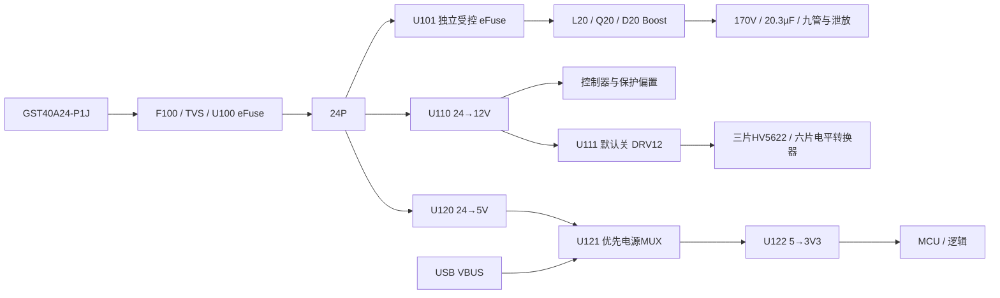

# S05 分层电路候选与原厂来源

2026-11-14。以下连接足以审查电源拓扑与关键引脚，但不是完整原生原理图，也不是可直接投产的BOM。所有候选均未获电气签核。`sources/manifest.json`记录PDF取得状态/哈希；未取得的原厂全文、器件模型、封装和动态验证是显式缺口。

## 1. 精确MPN与来源矩阵

“原厂已读”只表示核查了列出的参数，不等于仿真模型或应用电路通过。每一行均须在S07按原厂机械图建立真实封装。没有把分销网页当作已核验原厂参数。

|位号/用途|精确候选MPN / 封装|原厂来源与本轮核查|剩余资格|
|---|---|---|---|
|适配器|GST40A24-P1J / 外置桌面式|[MEAN WELL规格](https://www.meanwell.com/Upload/PDF/GST40A/GST40A-SPEC.PDF) p2：24V/1.67A，±2.5%、150mVpp|实际线缆、插拔、AC线及地区认证标签|
|U100/U101输入/HV切断|**TPS26601RHFR** / RHF QFN24，EP|[TI TPS2660 Rev.G](https://www.ti.com/lit/ds/symlink/tps2660.pdf) §5–9：4.2–60V、集成背靠背MOS、26601的MODE开路为断路器锁存；**不是26600自动重试型号**|RHF真实焊盘、原厂动态模型兼容、短路及SOA/热验证|
|D100输入TVS|SMBJ33CA-E3/52 / SMB|[Vishay 88392](https://www.vishay.com/docs/88392/smbj.pdf)：33V双向，表内53.3V@11.3A，600W规定脉冲|源阻、温度与寄生L；600W不等于允许持续过压|
|F100|0451001.MRL / 2410|[Littelfuse 451系列入口](https://www.littelfuse.com/products/fuses/surface-mount-fuses/nano2-fuses/451)|精确额定表和I²t原厂全文未取得；暂定1A，不能声称能清除所有限流电源故障|
|C100输入大电容|EEUFR1J470 / 径向|[Panasonic FR资料入口](https://industrial.panasonic.com/ww/products/pt/aluminum-cap-lead/models/EEUFR1J470)：候选47µF/63V|原厂完整参数下载未成功；ESR、纹波、寿命、机械图待审|
|C101/CIN去耦|GRM188R72A104KA35D / 0603|[Murata精确料号查询](https://www.murata.com/en-us/products/productdetail?partno=GRM188R72A104KA35D)：候选100n/100V|精确产品页/偏压曲线待归档，不继承旧25V电容|
|U110/U120|**LMR51610XDBVR** / DBV SOT23-6|[TI Rev.B](https://www.ti.com/lit/ds/symlink/lmr51610.pdf) §4–6、§8：65V、1A、400kHz、PFM、0.8V参考；该X型号明确为400kHz|PFM纹波、LC稳定性、热与短路；没有PG脚|
|L110 AUX12|MSS1260-104MLD / 12.3×12.3mm系列|[Coilcraft MSS1260](https://www.coilcraft.com/getmedia/febefb9b-60f9-4a2c-8525-9c396f34e363/mss1260.pdf)：100µH ±20%|低负载PFM与温升|
|L120 5V|MSS1260-333MLD / 同系列|同上：33µH ±20%|开关峰流、温度与布局|
|U111受控DRV|**TPS22810DBVR** / SOT23-6|[TI Rev.C](https://www.ti.com/lit/ds/symlink/tps22810.pdf) §5–7：2.7–18V，DBV为6脚；CT与QOD|默认关、掉电反灌、QOD能量、驱动器掉电隔离；不将其视为反向阻断器|
|U121电源选择|**TPS2116DRLR** / DRL SOT-5X3-8|[TI Rev.A](https://www.ti.com/lit/ds/symlink/tps2116.pdf) §5、§7–8：1.6–5.5V、2.5A，反向阻断、优先模式、先断后合|供电切换、输入过压、USB浪涌；不是USB协议限流器|
|U122逻辑降压|**TPS62162DSGR** / DSG WSON8+EP|[TI TPS6216x Rev.E](https://www.ti.com/lit/ds/symlink/tps62162.pdf) §5–6、§9：固定3.3V、3–17V、1A，带PG；固定型号FB接AGND|PSM输出容差、USB启动与WSON焊接散热|
|L122|MSS1260-222NLD / 2.2µH ±30%|Coilcraft原厂表，作为TI推荐2.2µH量级的具体候选|1.54µH最低值下纹波/峰流与控制稳定性；尺寸非优化|
|U20 PWM|**UCC28C43DR** / D SOIC8|[TI Rev.I](https://www.ti.com/lit/ds/symlink/ucc28c43.pdf) §6–8：CS 0.9–1.1V、延迟最大70ns（规定条件）；RT15.4k/CT1n示例110kHz|偏置12V及温度下完整规格/模型、启动跨模式和斜坡；不复用旧UC3843行为模型|
|L20 HV磁件|**MSS1260-154KLD** / 系列机械图|Coilcraft原厂PDF：150µH ±10%，DCR最大216mΩ；25°C的10%降感电流1.58A、20°C温升RMS1.20A|热态L(I)、磁损与温升；网页取整1.6A不用于扩大裕量|
|Q20|**STP9NK50Z** / TO220，1G/2D+tab/3S|[ST DS2787 Rev.3](https://www.st.com/resource/en/datasheet/stp9nk50z.pdf) p1–3：500V、RDS(on)≤0.85Ω@10V；Qg典型32nC；[官方产品状态](https://www.st.com/en/power-transistors/stp9nk50z.html)为Active|本地PDF下载超时，网页原厂已读；Qg按64nC分配不是原厂最大保证；非线性Coss/门驱与SOA|
|D20|**US1G-E3/61T** / SMA DO214AC|[Vishay 88768](https://www.vishay.com/docs/88768/us1_test_dcicons.pdf) p1–2：400V/1A，50ns恢复的指定测试条件|真实工作点恢复/结电容/热；旧Diotec UF4007模型不代表Vishay|
|R230新电流分流|**RL2512FK-070R82L** / 2512，候选0.82Ω/1%|[Yageo原厂入口](https://www.yageo.com/en/Product/Index/rchip)：RL低阻系列|精确原厂全文/脉冲/温漂待取得；计算按1W设计分配，未取得保证不能签核|
|R34A/B反馈上臂|**TNPW12061M00BEEA** ×2 / 1206|[Vishay TNPW e3](https://www.vishay.com/docs/28758/tnpw_e3.pdf)：选0.1%、25ppm级，1M编码|完整订货码/可供值与温漂、工作电压复核|
|R35A/B反馈下臂|**TNPW060329K4BEEA** + **TNPW0603453RBEEA** / 0603|同上，29.4k+453Ω=29.853k|初始容差之外的偏流/热漂，不能只验名义比值|
|C11/C12|**ECQE2106JF** ×2 / THT薄膜候选|[Panasonic型号目录](https://industrial.panasonic.com/ww/products/pt/film-cap-electroequip/models?list=1&order=atr-ind-pRDI0000J1_3_A002&page=1&sort=desc)；[原厂型号编码说明](https://api.pim.na.industrial.panasonic.com/file_stream/main/fileversion/4042)：2=250V、106=10µF、J=5%|原厂逐型号尺寸/允许纹波/dVdt全文待取得；**尺寸明显大于旧占位SMD，不可直接落板**|
|RT / CT|**RC0603FR-0715K4L** / 15.4k；**GRM1885C1H102JA01D** / 1n C0G50V|TI UCC28C43 §8.2.2.6示例确定参数；Yageo/Murata精确产品资料待归档|CT加载、阈值和频差未资格化|
|CS滤波|**RC0603FR-07100RL** / 100Ω；**GRM1885C1H221JA01D** / 220p C0G50V|22ns设计时间常数；最小单元6例结果在`sim/cs_v1`|真实噪声和源极寄生仍未知|
|可选RC吸收|**GRM31A5C2J101JW01D** / 100p630V；**CRCW2512330RFKEG** / 330Ω|仅具体检索候选，[Murata入口](https://www.murata.com/en-us/products/productdetail?partno=GRM31A5C2J101JW01D)、[Vishay CRCW](https://www.vishay.com/en/resistors-fixed/crcw/)|原厂料号表、脉冲功率及封装待审；DNP，不计作已有吸收设计|
|保留三片HV驱动|**HV5622PG-G** / PQFP44|[Microchip DS20005854A](https://ww1.microchip.com/downloads/en/DeviceDoc/20005854A.pdf) p4–5：VDD10.8–13.2V，高速测试最大15mA/片|三模块真实刷新、消隐、掉电反灌与96bit链回归|

## 2. L0：24V输入与独立切断

候选连接：适配器正端→F100→VIN_RAW；适配器负端→GND。D100双向TVS与C101=100n/100V跨VIN_RAW–GND。双向TVS避免逆接时的持续正向短路；**极性电解C100=47µF/63V放在U100之后，跨24P–GND**。VIN_RAW只用无极性电容，预留无极性阻尼支路，热插拔输入LC阻尼尚未资格化。

U100=TPS26601RHFR：IN8/9→VIN_RAW；OUT23/24→24P；GND17→GND；RTN15和EP→专用RTN100；所有设置元件返回RTN100，**不能把RTN和GND在图上随意合并而破坏反接工作**。NC1–7/11/16/21不接。ILIM19以12.0k接RTN；MODE13悬空（26601断路器锁存）；dVdT20以47n接RTN；FLT22开漏上拉到3V3；IMON18不用则悬空；SHDN14用于硬件全输入关断，启动时允许其内部上拉。UVLO10独立160k/10k分压，OVP12独立240k/10k分压，分压自VIN_RAW到RTN；名义20.23/29.75V。1%电阻及阈值角点约19.60–21.22V与28.69–31.22V，最低工作21.6V仍有余量，未计RTN偏移/噪声。反接时所有外围不得把RTN拉回USB地。

U101同料号：IN8/9→24P、OUT23/24→HV_IN24；自己的RTN101/EP与设置网络；ILIM20.0k对应名义0.6A；MODE悬空；47n斜率；OVP同U100，UVLO改150k/10k，名义19.04V、上角约19.97V，避免重复使用主输入阈值后被级间压降阻止启动。F100及其到U100输入的连接分配压降≤0.15V，使插口最低21.6V时VIN_RAW≥21.45V，仍高于U100最高启动阈值21.22V；这只是电压分配，待实测。SHDN以**10k下拉到RTN101默认关**，硬件许可通过限流/隔离驱动拉高；驱动级尚未完成，因此此端口保持未连接/关断。严禁GPIO单独越过AUX_OK、DRV_OK、3V3_OK、互锁与锁存。FLT100/101分别记录，不把FLT当作足以证明电源电压合格的独立PG。

两级eFuse稳态以各250mΩ角点估损，不能用150mΩ典型掩盖热；原厂限定条件之外需再审。47n和充电电流4.7µA、增益24.6对应26.4V斜坡约10.73ms。24P本地先分配47µF：输入电容充电能约16.4mJ，线性充电过程开关内耗同量级；需连同DC/DC启动电流校核SOA，而非凭能量小宣告通过。短路实际响应/布线L/限流后的热关断用原厂模型和实物低压单元确认。F100不能代替eFuse；U101关断也不能释放已经储存在C11/C12内的能量。

TVS53.3V额定测试点低于eFuse60V推荐上限/62V绝对最大值，仅是静态初筛；温升和寄生L可能越限，**没有宣称通过IEC浪涌**。输入40V/1ms测试时主要依靠OVLO切断，TVS不能保证40V就钳位。

## 3. L1：AUX12与受控DRV12

U110=LMR51610XDBVR：VIN5→24P，GND2→GND；CB1–SW6间100n；SW6→L110(100µH)→AUX12；FB3上140k、下10k到地，名义0.8×15=12V；EN4接24P（本器件允许），输入2.2µF/100V+100n本地、输出2×22µF/25V X7R，**有效容量/DC偏压与完整MPN仍需资格确认**。PFM轻载下不能把CCM纹波公式当输出纹波保证。

AUX12供U20、保护与PG偏置；不通过DRV开关供PWM，以免建立循环启动依赖。U111=TPS22810DBVR：VIN1→AUX12、GND2→GND、EN3→DRV_PERMIT并10k下拉；CT4以10n到GND作为斜率候选；VOUT6→DRV12；QOD5经1k到DRV12。负载至少MAIN/L/C/R去耦与电平转换器的实际总电容，必须验证放电耗能/掉电顺序，不能只用手册空载CT示例。三模块HV5622的VDD30/POL27、向上转换器VDD及向下转换器高侧VCC均保留DRV12域；接插头原DRV_VDD脚仍是12V。模块16V去耦改25V候选，不能接24V。

独立PG需要同时监测AUX12窗口、DRV端窗口与3V3窗口。LMR51610无PG，U122的PG不能代替其它轨PG。比较器/基准/迟滞与掉电钳位尚未设计完成，故DRV_PERMIT/HV_PERMIT本轮不接到真实启用源。正常顺序要求：24P→AUX12与3V3合格→保持BL禁显→初始化链→DRV12合格→硬件HV许可→HV稳定→允许显；任何PG丢失同时撤PWM/HV输入许可并消隐。失去偏置后仍须保持关断，S06验证。

## 4. L2：3V3与USB

|方案|能量分配（效率假设均80%）|具体连接及选择|
|---|---|---|
|直接24→3V3|2.64/0.8=3.30W；较两级少0.825W分配损耗|可用LMR51610XDBVR，FB31.2k/10k，正常约206ns导通@26.4V/400kHz；USB还需独立3V3转换和3V3电源选择；800mA负载瞬态待验|
|24→5V→3V3|2.64/(0.8²)=4.125W；不是已测效率|本轮优先，5V/USB在同一选择器前汇合；保留USB离线编程方向|

U120同U110引脚：VIN5=24P，SW6→L120(33µH)→EXT5；FB3以52.3k/10k设置**4.984V**，CB1到SW6=100n；EN4接24P；输出2×22µF/16V X7R候选。参考/分压最高正常角点必须留在MUX5.5V内，失效输出24V则会损坏MUX：该单故障尚无独立5V OVP，列阻塞，不允许只依靠正常反馈。

U121=TPS2116DRLR：VIN1(3)=EXT5，VIN2(6)=USB_VBUS，VOUT(2/7)=5V_SYS，GND1=GND；MODE5接EXT5；PR1(4)以316k/100k取自EXT5，名义选择阈值4.16V；ST8开漏上拉3V3。PR1参考0.92–1.08V本身使阈值约3.83–4.49V，尚需连电阻公差/掉电动态审核；不能把4.16V写成保证切换点。输入各1µF/10V，本地5V_SYS先选10µF/10V；实际USB直接可见电容和MUX启动充电还须核算。地不隔离；反向阻断针对电源通道，不能阻止D+/D−/GPIO/接口钳位反灌。

U122=TPS62162DSGR：PGND1/AGND4/EP接局部地；VIN2=5V_SYS，EN3接5V_SYS；FB5接AGND（固定3.3V型号），VOS6取3V3输出；SW7→L122(2.2µH)→3V3；PG8上拉到3V3。输入10µF/10V、输出22µF/10V；MPN/有效容值与负载阶跃待完成。PG未上升期间MCU复位，3V3输出总电容/模块去耦必须并入启动负载。

USB模式HV/AUX/DRV均无外部24V，不应被逻辑信号反向抬升；固件禁止HV请求/无线功能。500mA已配置USB电源、4.75V、3V3负载450mA、η=80%时在名义3.3V约397mA输入；按3.465V上限加30mW预留为416.6mA，留约83.4mA余量；**该预算不解决启动时未枚举100mA限制**。本轮保留兼容目标，不把MOS OR或MUX选好写成USB离线编程已实现。下一步必须测ESP32复位前/枚举时峰值、输出预充及主机能力，再决定是否需BC1.2/Type-C电流识别和受控启动。USB口ESD/连接器/数据线逐针沿用审核清单，不能直接删掉。

## 5. L3：170V功率级、C10与CS

HV_IN24→L20=150µH→SW_HV；Q20 D2/tab→SW，S3→R230功率正端；R230=0.82Ω→GND_HV功率回路。D20 A→SW、K→HV_BUS。C11/C12各10µF/250V并联HV_BUS–GND_HV，模块3×100n仍在HV_BUS。九管各20k串阳极不变；不允许把管电流上限当成任何电压下自动成立的恒流特性。

U20=UCC28C43DR：VDD7→AUX12（本地100n+10µF/25V），GND5独立Kelvin回R230负端；VREF8本地100n并供RT=15.4k至RTCT4，CT=1n C0G从RTCT4至Kelvin地；OUT6经22Ω到Q20 G1，G–S间10k默认放电，预留外部15V栅钳位（具体MPN/钳位容差未定）；**门驱参考是Q20源极，不是随意远端数字地**。64nC栅电荷分配、110kHz上角126.5kHz时约8.10mA/97mW，计在AUX12，未再计入HV效率预算。22Ω/10k与钳位是候选，真实关断时间100ns分配须证实。

R230正端单独Kelvin线→R36=100Ω→CS3，220pF从CS3到Kelvin负端。CS与SW无电阻连接；源极大电流回路不得串入参考/CT回路。最小滤波仿真仅证明这个RC在理想斜坡与规定噪声下的响应，未模拟PWM/比较器/门极锁存。0.82Ω下计±50mV误差、1%电阻、70ns比较器与100ns门驱预算，最早限流约1.026A、最迟峰值约1.458A；磁件25°C 10%降感值1.58A仅有约8%电流余量，热态可能不够，故不能签核。旧0.15Ω在1.1V阈值下对应7.33A，不能沿用。

反馈：HV_BUS→两支1M/0.1%串联→FB2，FB2→29.4k+453Ω/0.1%→Kelvin地；名义169.987V，计参考初始±1%与分压初始容差约167.96–172.03V；偏流/温漂/回流误差仍待加。COMP1的补偿与软启动未连接为已审查参数，禁用端口默认拉低COMP（具体失电安全执行级待S06）。不预充、不用理想电压源冒充稳定HV工作点。

原C10=10n直接跨SW–HV等效跨整流二极管。170V电压摆幅的0.5CV²=144.5µJ；110kHz的0.5CV²f/CV²f分别15.90/31.79W，是能量换流量级，**不是实测C10损耗**。原C10不带入新候选。为抑制寄生振铃，另列Q20 D–S串联100pF/630V+330Ω RC（默认DNP）；180V/126.5kHz的CV²f量级0.410W，电阻需脉冲/平均双校核，不能凭“1W”标签通过。吸收须由非线性Coss、二极管恢复、布线漏感及真实波形确定，不能用10n随意压波形。

正常稳态的648点理想筛查覆盖Vout164.9/170/175.1、输入20.5/24/26.4、L初始±10%及额外降感10%、频率±15%、消隐及三档管电流与泄放公差。最大峰流0.931A、RMS0.411A，最小空闲20.78%；只是规定HV窗口下DCM。**启动接近Vin及输出短路不在这个证明内**，真实启动可能CCM；DCM工作D可达69.95%，不能单凭D>50%就把DCM判成不稳定CCM，也不能反向据稳态DCM忽略启动斜坡。

CCM时原厂要求足够斜坡；在Vout175.1V、Vin20.5V、L121.5µH下，约半下降斜率的量级为0.52V/µs（折算0.82Ω）。直接从CT经小电阻注入会加载定时电容并改变频率；本轮没有合格缓冲器/幅度/CT加载模型，故斜坡端口保持未审查。需要在限制启动模式、零流检测DCM策略或缓冲斜坡三条路线中完成资格选择，**24V-07未通过，不进入24V-08**。
