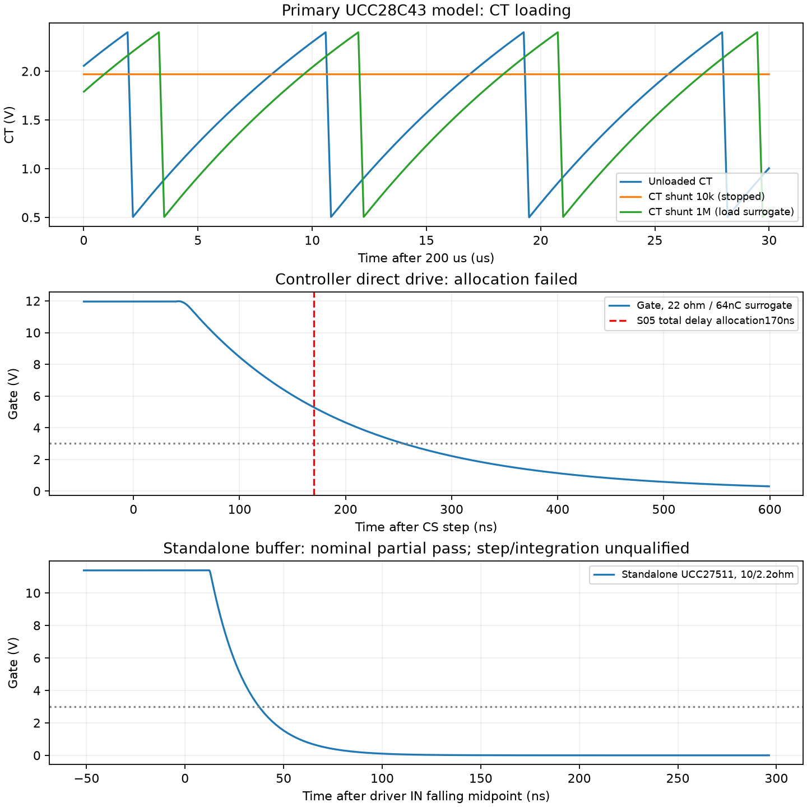

# 24V重构 Sprint06 执行报告

工作跨2026-11-14～15，结项记录：2026-11-15，Asia/Shanghai。

**已写方案并执行单元资格工作：取得可运行的原厂控制器模型，完成25次仿真执行、反馈/功率/PG角点计算，并形成磁件、反馈、门驱、AUX与许可电路增量。24V-07仍未通过，24V-08未进入；制造HOLD继续。**

本轮不是完整24V电路、原生图或整机电气验收完成。原厂模型运行成功与完整器件资格分开登记；不使用170V预充，不进行闭环扫参，不采购、不输出制造包、不实物高压上电。

## 交付入口

|交付|文件|
|---|---|
|执行前方案与判据|[SPRINT06_PLAN.md](SPRINT06_PLAN.md)|
|本轮有效参数增量|[config/sprint06.json](../config/sprint06.json)，继承S05要求；未改变170V目标与外部输入要求|
|器件/连接/误差处置|[S06_CIRCUIT_DELTA.md](S06_CIRCUIT_DELTA.md)|
|功率、限流、反馈、PG/复位及USB解析|[analysis.json](sprint06/analysis.json)、[功率表](sprint06/POWER_RAILS.csv)、[反馈角点](sprint06/FEEDBACK_CORNERS.csv)、[PG角点](sprint06/PG_THRESHOLDS.csv)|
|原厂模型来源/范围|[MODEL_QUALIFICATION.csv](sprint06/MODEL_QUALIFICATION.csv)，原件和下载失败记录位于`sources/sprint06/`各manifest|
|全部实际仿真执行|[EXECUTION_MATRIX.csv](sprint06/EXECUTION_MATRIX.csv)，各`sim/s06_*`目录保留预登记/脚本/模型/命令/日志/波形/结果|
|核心候选引脚增量|[s06_candidate_power_pins.csv](../netlist/s06_candidate_power_pins.csv)，仍不完整且禁止用于原生生成|
|完整性与门槛结果|[final_verification.json](sprint06/final_verification.json)|
|下一轮接续断点|[BREAKPOINT_S06_2026-11-15.md](BREAKPOINT_S06_2026-11-15.md)|

## 1. 本轮解决/发现了什么

1. **纠正S05反馈的资格缺口。** 原两支1M方案没有把全温VFB、输入偏流储备和电阻温漂一起算入。按VFB2.45–2.55V、±2µA保守偏流储备、0.1%与25ppm×75K的组合，旧候选约**161.66–178.38V**，超出164.9–175.1V均值要求。把上臂改两支100k、下臂改2.94k+45.3Ω后，本轮误差预算约**165.25–174.77V**。尚未计入的实际偏流条件、有限增益/布局/额外调压误差仍需审查，不以此宣布稳压通过。
2. **重选磁件以增加限流余量。** MSS1583-154KED保留150µH，25°C的10%降感电流3.1A，DCR最大159mΩ，原厂指定400V工作电压。门驱按300ns新研究分配后最迟峰流约1.502A；若要求20%热态余量，热态10%降感电流需至少1.877A。这个热态值尚未证实，不能用3.1A常温值代替。
3. **门驱旧分配未通过。** UCC28C43直驱22Ω，在64nC/12V等效线性电容下约253–254ns才降到3V，超过S05的170ns总分配。新增UCC27511DBVR、10Ω开通/2.2Ω关断候选，独立夹具部分约38–40ns；但一步长例崩溃、两模型联接出现数值失败，不能以部分结果关闭门驱资格。
4. **取得并执行真正原厂控制器模型。** 初取库为加密版本，继续检索取得TI公开SLUM521未加密UCC28C43模型。原文件不改数值，在ngspice的PSpice兼容模式下完成振荡、UVLO、CS与CT负载夹具；没有用旧UC3843家族行为模型代替精确候选。
5. **把PG与许可推进到具体器件/阈值/引脚连接。** TPS3700DDCR各轨窗口、独立启动有效延时、SN74LVC1G14/1G11逻辑及SHDN分压均有候选。修正3V3 OV误触发风险，拒绝G33复位候选，提出TPS389001DSET。DRV自身PG仅参与HV许可，不参与DRV自身启动，避免启动死锁。部分供电、反灌、掉电动态和锁存来源仍未通过。
6. **USB缺口被定量化。** 未配置100mA时可供3V3上限约109.7mA；假定800mA峰值时22µF输出电容只支持约4.38µs的小幅跌落。这个研究例不是真实ESP32波形；保留USB离线编程目标，不宣布普通USB主机兼容，不通过任意加电容掩盖枚举/浪涌要求。

新的反馈支路及驱动器额度使HV侧预算变为约**5.7156W**，AUX12额度约**99.096mA**，整机预算约**13.8628W / 0.6418A@21.6V**。此值取代当前设计候选下S05的13.6640W；S05历史结果保留。效率仍为分配/要求，尚非已测或保证性能。

## 2. 原始试验结果及资格边界

共**25次仿真执行，含重复夹具、负面对照及失败**；22次到原生终点、3次执行失败；16次仅在各自有限判据内通过。不能把“16次部分通过”当完整模型或整机通过。

|运行目录|执行次数|关键结果|工程结论|
|---|---:|---|---|
|`sim/s06_controller_v1`|7|原厂UCC模型：振荡约115.3kHz，10/5ns频差约0.0267%；UVLO约8.400/7.599V；CS→OUT半幅约52.1/52.6ns|6例有限范围通过；CT并10k例停振，负面对照FAIL|
|`sim/s06_controller_v2`|9|增加门极诊断及输出取样节点；振荡/UVLO/CS再核；含额外1nF测试负载的门驱约260ns|6例有限通过；CT10k及两例直接门驱失败。门极夹具额外负载问题留记录，不据此签实际门驱|
|`sim/s06_gate_v3`|2|移除额外1nF输出负载，仅保留5.333nF等效64nC门极负载；10/5ns对照约253/254ns到3V|修正夹具后仍超170ns分配，2例均FAIL；不是实际ST MOS测量|
|`sim/s06_buffered_gate_v1`|2|UCC+UCC27511两原厂模型联接；约46/20µs停止于`xu.gb6_int1`|2例timestep-too-small，尽管rc0也判执行FAIL；不得使用截断结果签核|
|`sim/s06_driver_unit_v1`|5|独立UCC27511，11.4/12.6V部分夹具关断约37.5/39.5ns，禁止与输入悬空时门极最高约6.43mV|4例有限通过；11.4V/1ns例rc3221226356且无波形，步长资格FAIL；整组未通过|

所有运行保存模型哈希、参数/判据、兼容配置、命令、原生日志与可得波形，失败也保留。UCC27511兼容副本只修复原厂TABLE点的一处漏括号，未修改电气数值，原始库和diff保留。

27°C名义模型不是全温/工艺角点。TI旧模型中的理想5V参考、输入电阻等不表达本轮全部最坏偏流与温漂；完整原厂规格还需另外审查。CS延迟比较用本夹具定义的OUT半幅，不宣称重现原厂全部测试条件。

早期S06获取/运行脚本日期字段沿用11月14日；工作跨日后新增记录使用11月15日。本轮未回写历史run的元数据，实际测试范围以各runner/模型/参数快照为准。



## 3. CT、前级与PG仍有哪些硬缺口

**CT/启动跨模式未完成。** 10k负载使CT停止于约1.97V；1MΩ负载约使频率下降0.69%（另一夹具结果略有变化），只支持高输入阻抗需求，不是一个实际缓冲器已通过。固定最坏CCM斜坡约0.522V/µs，会在约1.92µs耗尽1V CS量程，不能直接作为正常满载DCM与启动的统一方案。需模式相关受限启动、零流检测或其它经证实策略；未进行闭环扫参。

**前级动态未通过。** TPS26601原厂TINA/PSpice库均为加密格式，ngspice未建立可执行的eFuse动态资格。原厂模型说明还不建模温度相关特性。反接、热插拔、短路、RTN偏移、实际SHDN延迟与SOA没有因本轮控制器模型通过而解除。S05 TVS、保险、输入阻尼与电容资格缺口继续保留。

**PG/复位静态改进仍不是动态安全。** TPS3700起始有效时间最多450µs需延时遮蔽；AUX掉电、逻辑半供电、GPIO/基集结反灌、输出漏电和快速输入跌落尚未执行真实器件级验证。新TPS389001静态下降下界约3.008V，离3.0V仅约8mV，必须核查最大传播延迟与供电跌落；不能用静态窗口宣布MCU不会欠压。FAULT_LATCH_OK/INTERLOCK_OK/HV_SAFE_ARMED的硬件来源尚未完成，保持默认不许可。

## 4. 24V-07门槛决定与后续顺序

**24V-07 NOT_PASSED；24V-08 NOT_ENTERED。** 这来自实际未满足的资格项，不是因为未建目录或未开始工作。没有可信的完整启动/功率级模型，本轮没有从预充170V冒充稳态，也没有为了推进阶段调整判据。

下一轮先做：

1. 处理UCC/UCC27511联接数值问题与1ns崩溃，保持原始失败；用独立夹具分离软件/模型兼容与真实电气行为，禁止靠放宽容差掩盖不收敛。
2. 补齐精确ST MOS/Vishay整流模型或替换有完整证据的具体候选，取得新磁件热态L(I)/损耗与门极/Miller验证；落实限流300ns分配的真实上界。
3. 为启动/跨模式选择可执行策略和具体缓冲/检测器件，完成CT加载及采样/锁存验证，再决定是否允许08。
4. 完成eFuse动态/SOA、PG/双复位/RTN/掉电执行级；处理USB枚举前启动与5V反馈单故障过压。故障锁存和安全复位仍属未完成硬件，不能让MCU越过。
5. 07满足后才建立从0V自主启动与可信闭环，再推进独立OVP、OC锁存/复位、泄放/拆模块单故障。原生图只接已审查候选；PCB仍等待08/09/10/11。

## 5. 工程状态与复现

24V-01/02保持“设计基线/预算交付完成”，不表示输入/整机实测通过；03～06仍为候选审查；07资格未通过；08未进入；11仅隔离数据准备。完整任务已更新S06证据入口。

工作区仍在历史分支`nxt/reva9-electrical-sprint03`，保留继承修改。本轮只在独立24V项目新增研究文件与更新入口/状态，不commit/push，不清理工作区。S05参数、报告、脚本、模型与原始仿真文件保留；最终哈希核对见验证记录。

当前结果复算只运行S06脚本；不要运行S05 finalize，它会回写旧状态。以下从仓库根目录运行：

```powershell
tools/review_venv/Scripts/python.exe projects/QS30-9_24V/design/sprint06_analysis.py
tools/review_venv/Scripts/python.exe projects/QS30-9_24V/design/sprint06_model_units.py --run s06_controller_new
```

第二条需要全新run名，不能覆盖现有目录；`--gate-only`可仅运行直接门极夹具，`--buffered`用于明确保留失败的联接模型诊断。`sprint06_driver_unit.py`固定一次性目录，重试须先修改运行器输出名并保存新快照。`sprint06_closeout.py`会更新当前项目入口/任务证据与清单，不是只读检查工具。
