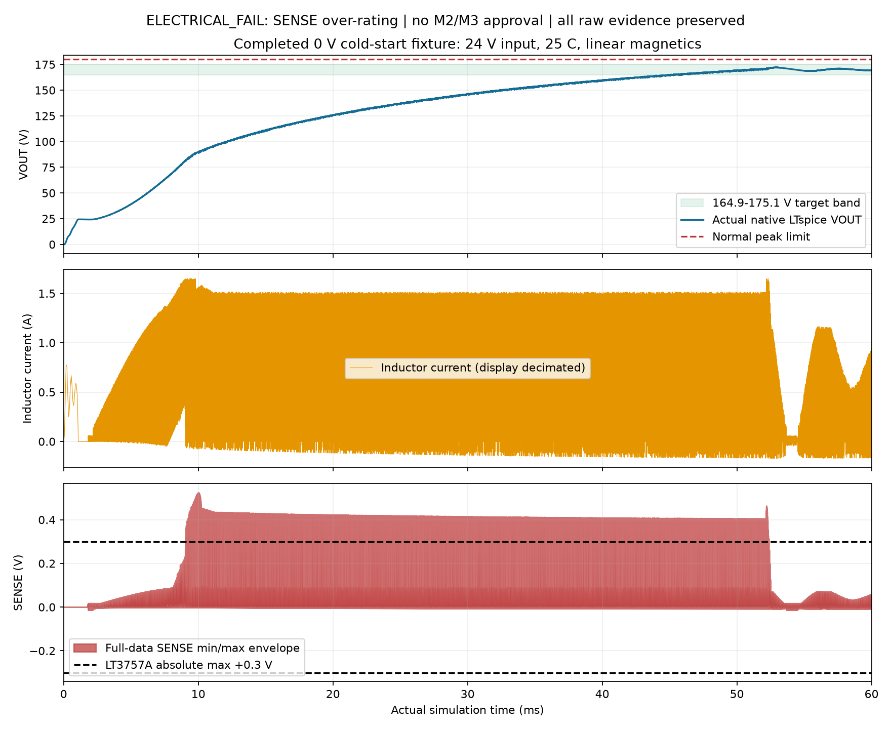
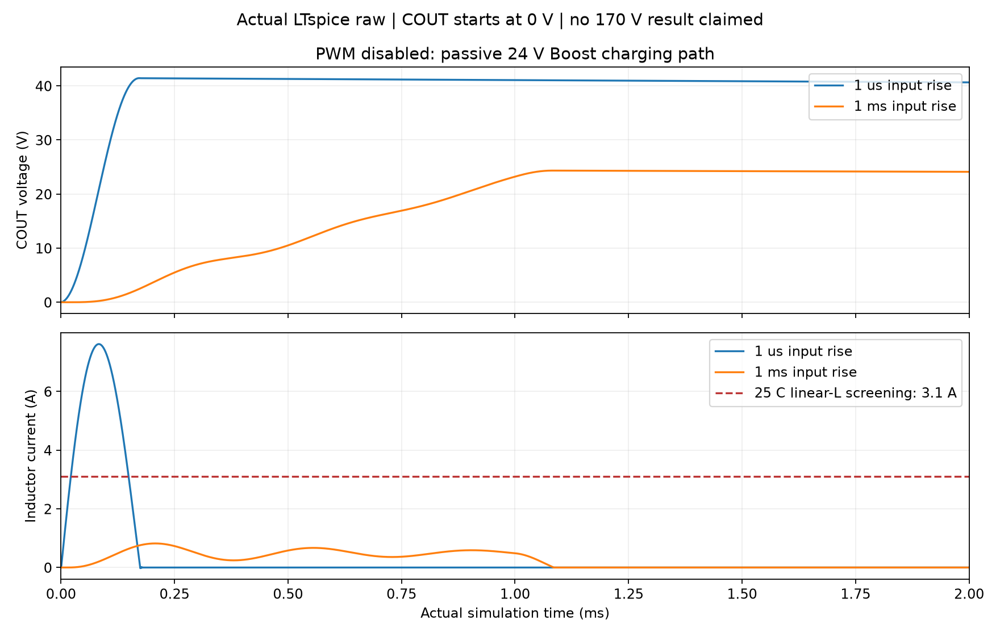

# QS30-9 高压闭环工程首轮实证报告

2026-11-17。独立开发分支 `nxt/qs30-power-loop-engineering-r1`；基于指定调度器分支 `nxt/qs30-power-loop-orchestrator-r1` 的6be8cbbf。原QS30-1工作区的未提交S06C–S06F记录未覆盖。**真实控制器从0V升到170V附近已经观测到，但当前候选ELECTRICAL_FAIL，M1完整器件资格、M2受控启动和M3闭环验收均未全部完成。制造及安全HOLD保持。**

## 真实完成的功率级仿真

`evidence/candidate_diagnostic/nominal_24V_gear_resource600/` 包含原始网表、模型hash、预登记、命令、原生日志、完整6331931点raw及独立测量。无170V/195V理想源，无固定PWM，无外部SS/VC命令，无非零输出初态。真实LT3757A模型参与电流/电压反馈。

|量|实测值|判断|
|---|---:|---|
|COUT初始电压|0V|真实零压初态|
|仿真终点|60ms，rc0；执行286.657s|完整到达预登记终点|
|进入164.9–175.1V窗并保持至本次终点|46.201893ms|该观察时段有限见证，不外推1s未来|
|全程输出峰值|172.078712V|该条件下低于180V|
|55–60ms输出均值|169.812477V|该观察窗口在164.9–175.1V|
|55–60ms原始波形跨度|2.430864Vpp|**未满足≤1Vpp**，也尚不能证明已完全结束启动尾部振荡；不改窗口/阈值冒充稳态PASS|
|50–55ms波形跨度|3.906488Vpp|残余动态明显|
|电感峰值/最小值|1.652049A / −0.172679A|线性25°C模型观察值，不能代替热态饱和/退磁资格|
|封装端VGS范围|−14.311789至11.974055V|该模型内未超±20V筛查，快速峰值未细化资格|
|SENSE最高值|**0.524358V**|超过ADI手册±0.3V绝对额定：**ELECTRICAL_FAIL**|

最坏SENSE事件发生在10.040718ms：IL约1.400474A，但分流端Vsrc/.062约9.035155A，整流管电流约−6.204601A。**电感峰流受限不能证明采样节点应力受控**。这些是模型内真实观测，尚未对该事件完成更细步长/跨算法等效检查，因此物理峰值大小仍INCONCLUSIVE；不能把它解释为实物必然精确达到这些值。

初始40–60ms分析窗口跨度13.462925V，包含实际46.2ms的启动入窗，不能称为纯稳态纹波；原分析失败文件原样保留，再公开两个后续窗口。后续2.43V仍不达标，不借分析窗口修订获得PASS。未模拟20MHz仪器带宽，以上为原始仿真跨度，不冒充台架测量。

## 明确区分执行失败与电气失败

|实验|实证|分类/解释|
|---|---|---|
|真实RC，两原生求解器|LT/NG均至1µs，终点0.632120566V，解析差约8nV|LIMITED_PASS：仅工具链|
|原厂ASC直接-b|60s超时，无网表|EXECUTION_FAIL：CLI/网表步骤，不能说芯片失效|
|原生-netlist后直接求解|rc0/1.5ms，但输出88µV|后来定位四个µ后缀被ACP936写成A6CC；属编码/执行错误。原worker“控制器或接线失败”的解释被否决|
|同参考，仅四处µ→ASCIIu派生|原模型字节不改，完成1.5ms；12→24V参考均值23.960860V、峰24.390367V|LIMITED_PASS：原厂低压参考的语义保真派生；不宣称网表字节未改，也不是170V证据|
|Gear完整启动，120s预算|至19.752487ms/约125.09V即超时|EXECUTION_FAIL；部分波形INCONCLUSIVE，不能说电气启动失败|
|Trap同拓扑120s对照|至21.788858ms/约129.33V超时|EXECUTION_FAIL；未完成终点，不能与完整Gear的全程峰混作收敛比较|
|唯一600s资源对照|同Gear网表/模型/容差/200ns maxstep，286.657s完成60ms|分离了执行预算因素；旧120s失败不覆盖。最终SENSE/波形问题属于模型内ELECTRICAL_FAIL|
|二进制解码器对照|压缩时间标记被严格拒绝；未压缩ASCII/二进制RC差6.24e−8V，严苛1e−14等价试验FAIL|工具范围失败保留，不能宣称格式逐点相同。两者均在原RC 1mV解析误差范围内；差异原因未完全分离，非器件资格|

## 独立被动路径反例与回归

真实控制器SHDN=0、COUT=0时，输入仍经L和二极管给电容充电。24V/1µs上升沿预测IL峰7.613877A、VOUT峰41.431947V、VGS最高0.11949V；**开关未被许可仍出现大电流**。超过MSS1583的25°C/3.1A线性筛查，不能把线性模型数值当作实际饱和电流上界。

1ms上升沿下IL峰0.820531A、输出峰24.340778V。50ns→25ns减半步长后，快/慢两例IL峰差约0.174µA/0.014µA，输出峰差约1.86µV/0.76µV。只支持这个被动夹具的可重复性，不验证实际eFuse上升沿、短路或热磁件。该反例阻止将内部软启动等同于整个0V启动电流受控。

## 控制器、器件与安全审查

优先继续LT3757A原生LTspice路线，完整比较见[控制器审查](CONTROLLER_REVIEW.md)，模型版本/适用范围见[兼容与可信度矩阵](MODEL_MATRIX.md)。这不是对UCC28C43性能优劣的同条件实测排名：本机缺PSpice/TINA原生环境。ST原模型明确限25°C，当前磁件是MSS1583-154KED而非旧MSS1260。热态L(I,T)、磁损、输入eFuse/AUX、精确COUT/钳位MPN和关键器件容差仍缺。

启动中并非所有周期都有可靠退磁见证。最初直接统计VGS过6V把振铃多次交越当成周期，原`cycle_review.json`的周期解释已否决并保留。独立2µs/4µs去重得到相同5498个候选边沿，后续观察仍有正向关断电流区间；它只是门极推导，未保存控制器OUT，不能签核实际开关频率或逐周期退磁检测。见`cycle_review_deglitched.json`。

独立补偿量级检查见`evidence/independent/compensation_screen.json`：实际并联负载约4801.65Ω、C20.3µF，RC时间常数97.47ms，被动RC极点约1.6328Hz。假设恒功率控制，线性化`C*dV/dt=P/V-V/R`给出约3.2656Hz输出极点；原厂12Ω/94µF参考的RC极点约141.09Hz，快86.41倍，而本轮借用的22k/6.8n补偿零点仍约1063.87Hz。该一阶近似不含真实电流控制、有限Vin及DCM/CCM转换，不能证明振荡根因或相位裕度，但明确否决“原厂低压参考补偿可直接继承稳定资格”的推断。没有据此擅自改R/C或再运行仿真。

双泄放按两串各2×90.9k计：170V总0.317931793W、每只0.079482948W。第一worker误算每只19.87mW已否决。S06C的5.716423382W是175.1V预算，须同电压加入0.183993789W，正确为**5.900417172W**；5.88985W混电压数仅保留为历史下界，未改变任何验收阈值。

安全系统H01–H10全部保留；尤其H02输入/eFuse路径、H05独立OVP能量、H06真实限流/热磁件/闭环、H08泄放故障均未关闭。24V-07未通过，24V-08不作为资格放行；09/10部分状态不变。没有采购、PCB下单、真实高压操作或安全认证状态变更。

## 调度与证据范围

复用既有调度器，首次联调最多两轮、七个worker session上限；实际计划六个Flash任务，当前Codex直接作独立决策，子Codex调用0。每个session内部有多次推理/工具调用，worker session数**不是API请求数或货币硬上限**。实际选模与用量记录在`evidence/preflight/dsh_runtime.json`。

第一轮baseline/model/acceptance已实际运行。UCC第二轮worker在900s上限停止，协调器明确INCONCLUSIVE/EXECUTION_FAIL；NG日志确有9ms/200255点，但导出脚本异常、最终协议未完成，不能给模型或电气PASS。原厂PSpice发布的.out也不能算本机回放。器件单元worker扩散到131个debug/fixture目录、当前fixture_checks未通过，且有超出ST25°C适用范围的扫描；Codex核对运行ID/进程/父进程后终止该单一worker树，保留其全部证据。131不是已核证仿真进程数，不能作为电气进度。该worker没有result.json，协调器INCONCLUSIVE。实际六个session，两轮已关闭，子Codex0，不再运行本轮模型任务。

封存目录为`evidence/worker_run_20261117T051440Z`，793项文件记录；30份唯一raw/大文本由45MiB上限gzip分片按SHA引用，原字节不归一。源程序/原模型及模拟器profile保留本机，不把整套厂商软件加入Git。首次归档因误遍历sim_profile触发Windows长路径错误，失败快照留在忽略目录，单独保存EXECUTION_FAIL及修复记录后重新冻结；源证据不改。

最终22项离线回归通过；归档630个EXACT_COPY及30个唯一raw/大文本的分片重构、长度和SHA全部核验通过，记录为`evidence/archive_verification.json`。这仅证明工具/数据完整性，不是电气PASS。原始profile和凭据均不发布，已确认无本轮仍运行的DSH或UCC子进程。

原S06C–S06F的42项报告/摘要/配置按原字节复制并登记SHA；原大raw仍在原工作区未变。本轮新raw按原字节压缩分片并附SHA，日志及失败不删、不用合成波形补缺。最初协调器只保存config/tasks/schema摘要而未封存每次修改前完整Python源码，这项首次联调审计限制明确保留；逐worker实际prompt和执行输出完整保存。

## 下一轮要减少的工程不确定性

1. 先在最小相关电流单元定位SENSE过压：区分整流器反向/栅极/吸收支路电流及接线、模型、数值影响。保存实际控制器OUT与端口电流，细化相同历史事件；钳位/滤波修改必须同时审查限流延迟，不用放宽容差或改TT掩盖。
2. 稳定性资格须分离启动尾部与稳态，按设计推导补偿后完成更长时间和至少两个步长/算法的共同完整窗口。当前2.43Vpp不能改成PASS。
3. 纳入真实输入充电、电源轨与热磁件边界后，才有条件关闭M2受控启动。之后仍须完整21.6/24/26.4V、负载跃变/100ms恢复及指定故障195V矩阵，才能评价M3。

这三项不是本轮已经完成的工作。本轮停止在所登记的模型调用/两轮边界，交付真实成功片段及未解决失败，不签发硬件合格结论。
