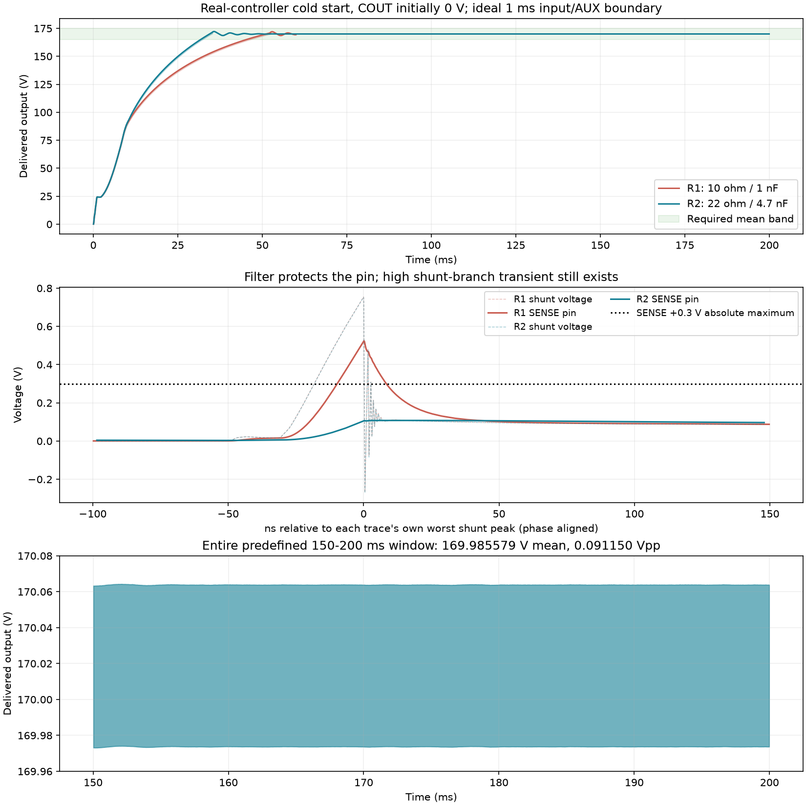
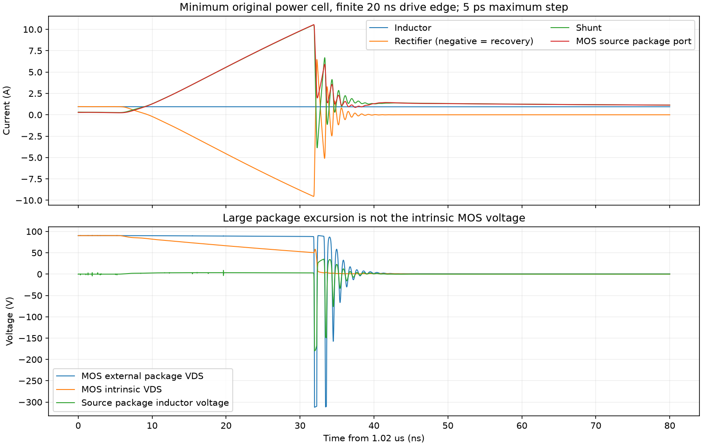
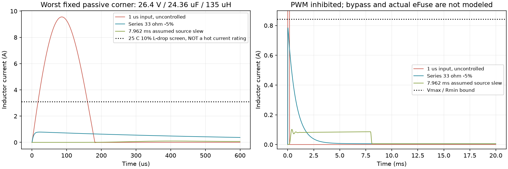

# QS30-9 高压闭环工程 R2：实证报告

2026-11-17–18。不可覆盖基线 `96a1afef5e55f84d002f754510b97d8cbd49334f`，独立分支 `nxt/qs30-power-loop-engineering-r2`。**形成了模型内采样保护、低纹波闭环及过载限流见证的候选；整个实际电源仍 INCONCLUSIVE / HOLD，未达到真实前级受控启动、热态、完整故障和硬件资格。** 24V-07/08/09/10、H01–H10 与制造状态均未关闭。无采购、PCB、真实高压或主分支合并。

## 1. 新获得的真实进展与前后对照

LT3757A 原厂模型和原生 LTspice 路线保持。只修改研究网表的采样 RC 网络：**10Ω/1nF → 22Ω/4.7nF**；62mΩ 分流、MOS、整流器、负栅支路和补偿均不变。所有真正冷启动 COUT=0，无理想 HV 源、外部 VC/SS 或固定 PWM。

|量|R1 原始 60ms|R2 完整 60ms（16线程）|R2 完整 200ms（1线程）|
|---|---:|---:|---:|
|SENSE 峰值 V|0.524358|0.109525|0.109549|
|电感峰值 A，线性25°C|1.652049|1.653455|1.653463|
|全程输出峰值 V|172.078712|172.286376|172.280067|
|55–60ms 均值 V|169.812477|169.983077|另见各完整原始结果|
|55–60ms 真实原始跨度 Vpp|2.430864|0.179359|另见各完整原始结果|
|150–200ms 整段均值 / Vpp|没有该窗口|没有该窗口|169.985579 / 0.091150|
|入164.9–175.1V并维持至各自观察终点|46.201893ms|见原始数据|32.170756ms|

旧 2.43Vpp 含启动尾振，不能冒称它是最终稳态再作百分比比较。R2 用**预登记整段 150–200ms**评价稳态，100–150ms 同样公开；连续10ms均值最大变化 0.000017770V。引擎线程数只作资源/数值对照，1/16线程60ms的均值、SENSE、电感峰值基本一致，没有提高容差。正常稳压结论只适用于登记的理想输入/AUX、25°C线性磁件与等效电阻。



图中长时间曲线为真实 raw 的分箱 min/max 包络及时间均值，局部尖峰使用完整保存样本；指标均由全保存波形计算，无仪器带宽滤波。

## 2. SENSE 异常：电流守恒与模型内根因

独立解码 R1 的 6,331,931点原始 raw，SHA `d8b11ebedbb1125bbd968bdaf3a4c6e6f691e7dae1872cf76b6d8411e8d260ba`。10.04071842377ms 的原事件：IL=1.400474A，DREC=−6.204601A，Vsrc=.560180V，对应分流9.035155A；SENSE=.524358V，漏极约−310.819V。不是把电感电流读错或把压缩时间位误当电流。

电感不是源极分流的唯一瞬时电流来源。定义 DREC 正向为 drain→HV，RNEG 为 neg→gate，MOS三端电流均以流入封装为正：

```text
IQd = IL − IDREC − IRSNUB
IQs = −IRSRC − IRF + IRGS − IRNEG
IQg = (VOUT − VG)/22 − IRGS + IRNEG
```

同一拓扑新增观测的 Gear200ns 最坏采样事件有 IQd=7.821010A、IQs=−10.002801A、IQg=2.181791A，三端和约22nA。**反向整流电流、吸收支路以及栅极/钳位回流可以令分流瞬态远大于 IL。** 原 worker“因缺内部探针而无法闭合任何KCL”的结论已否决。零伏端口探针、之后取得的原生 `Ix(q:1/2/3)` 互校一致，不能把单纯代数重排冒充独立端口测量。

0–10.08ms 完整 Gear200ns/Gear100ns/Trap200ns 三例 SENSE 峰值 .525075/.519531/.528964V，IL峰值仅约1.652A。切换相位变化明显，不能硬对齐同一绝对时间；最坏峰幅却未随减半步长消失。原始元件和收敛容差全不改。

去掉控制器的局部功率单元，用明确89.17V/1.4A初态与有限20ns门沿隔离器件网络：1ns、.5ns、Trap1ns 仍出现约10.53A分流及.419–.420V采样峰。进一步10ps/5ps，分流峰10.52278/10.52357A，固定1.02–1.10µs窗口整流负电荷112.6257/112.5999nC。支持**储存电荷反向恢复与封装寄生/栅回路耦合的模型内机制**，不是控制器限流失效这一单一原因。

封装端约−311V不等于MOS本征VDS：保存内部节点后，本征VDS最低约−.651V，内部VGS约−.412～11.909V；大电压主要落在模型原有LS/LD上，整流器出现约400V反向雪崩样状态。没有重复添加封装电感，也没有修改TT/BV掩盖。**实际器件的尖峰幅值、Qrr/雪崩/脉冲及热态资格仍 INCONCLUSIVE。** 理想电感净能量恒等式仍有残差，细步长与极小的绝对功积分误差量级不能替代净能量判据；LT默认电感损耗也未被排除。个别内部二极管支路没有直接导出，不编造其电流。

局部单元继承的网表标题含“cold start/COUT0”，与其实际IC=89.17V不符。标题、网表和SHA原样保留并显式纠正解释：这些单元**不是**0V冷启动或170V资格；真正正常启动的COUT始终为0。



## 3. 采样修正与真实限流保留的有限见证

Codex 在执行前审查采样 RC。依据 [ADI SENSE Programming](https://www.analog.com/media/en/technical-documentation/data-sheets/LT3757-3757A.pdf) 的100ns消隐和22Ω、2.2–10nF抗振铃范围，选22Ω/4.7nF，时间常数10ns→103.4ns。分流没有减小；没有钳住一个持续大电流然后将其隐藏。新增冷态斜坡延迟量级约20mA（26.4V/135µH），65µA偏置只是典型值，不能拿它保证抵消最坏延迟。

完整60/200ms、21.6/26.4V、两种额外数值设置及负载过载都核对真实 IL 和 SENSE。额外0–12ms Gear100ns / Trap200ns 的 SENSE 为 .109448/.109414V，IL 为1.653344/1.653499A，满足登记的峰值重复性筛查。正常200ms最坏 SENSE 范围 -0.006413～0.109549V，原始分流支路仍约12A；不把针脚保护误说成所有功率器件尖峰消失。

80ms后将主等效负载从5200Ω变为1000Ω并持续至160ms，得到**限流/掉压行为见证**：电感最大 1.653477A，SENSE最大 0.109549V，输出末段均值 114.099097V。它是超出正常6W筛查的过载，不是170V稳压PASS；也不是硬短路、真实eFuse切断、热态SOA或完整195V独立OVP资格。当前典型模型下，没有观察到滤波破坏真实电感限流。

## 4. 被动充电与受控启动资格

复核原1µs与1ms及减半步长波形，原7.613877A/.820531A结论不变。新增最坏固定研究角点26.4V、24.36µF、135µH、PWM禁止：

|方案|IL峰值 A|实证/限制|
|---|---:|---|
|1µs无控制输入|9.557206|越过25°C线性降感域；不是实际饱和峰上界，ELECTRICAL_FAIL线性筛查|
|真正串联33Ω取−5%=31.35Ω|.785097|低于26.4/31.35=.842105A边界；局部电流限制LIMITED_PASS|
|7.962353ms参数化输入斜率|.102235|只是手册参数/电容假设的源斜率夹具，绝非eFuse原生模型PASS|

预充模型电阻峰功率19.323W、正常20ms积分能量7.937mJ；纯短路上界功率22.23W且时间未受保证，不能用正常能量给短路脉冲额定放行。33Ω永久串联在21.6/24/26.4V下最大可交付功率仅3.535/4.364/5.280W（尚未扣转换损耗），**必须有经过资格化的旁路才能承担6W**。旁路、默认关监督、故障能量/最大关断延迟和确切脉冲器件仍缺，不能虚构已实现完整受控启动。

U101原设置20kΩ、MODE开路、CdVdT47nF。MODE开路是断路器锁存，不是连续限流。研究候选为MODE402kΩ到自身RTN的主动限流锁存路线；所有设置/隔离/故障协调还未在实际前级网表资格化。TI当前PSpice/TINA包重新下载后与历史SHA一致、仍加密；本机未取得受支持原生动态和温度模型。5.5µA、增益25.5、假设总最小42.3nF算得3315.603V/s、26.4V最短7.962353ms；先前8.49ms算术条件原样保留并更正。真实电容全温/偏压、完整Vin范围、RTN/许可及典型250ns快断不能当最大保证。

**Codex决定：实际HV许可保持默认关/HOLD；只允许隔离条件下的闭环研究。** 受控U101斜率与独立PWM抑制是主研究路线，分立预充+旁路是有电阻边界的候选备份。没有从输入首次建立到170V的真实完整前级资格，P0-B / M2不能通过。



## 5. 稳态、反馈与回归实际结果

R1 40–60ms频域包含启动尾部；5ms FFT首个200Hz频点不足以证明200Hz环路自激。独立频谱采用均匀重采样、明确窗口/去趋势/分辨率，不以频谱替换原始Vpp。实际并联负载为4801.650430Ω，170V总6.018764W；双泄放是两串各181.8kΩ并联，不能再重复并联成45.45kΩ。

解释性DCM平均模型：`Iout=L*f*Ipk²/[2*(Vo−Vin)]`，与电阻负载共同线性化得到输出极点约3.534Hz。假设100kHz时Ipk约.830A、导通/退磁占比约.519/.085；实际控制器OUT的晚期503个周期中位100.847kHz、占比.545、IL峰中位.870A，可作量级交叉检查。CCM RHP零点只保留其适用条件，不向实际DCM套用。22k/6.8n零点1063.87Hz、100p并联高频极点约73.407kHz；没有Bode增益/相位裕度资格，**补偿保持22k/6.8n/100p，未直接继承低压示例的稳定证明**。

|条件|预定义窗口|均值 V|真实Vpp|全程峰 V|SENSE峰 V|IL峰 A|模型内结果|
|---|---|---:|---:|---:|---:|---:|---|
|24V nominal|150–200ms|169.985579|0.091150|172.280067|0.109549|1.653463|LIMITED_PASS|
|21.6V|80–120ms|169.982668|0.092938|172.069783|0.106199|1.648900|LIMITED_PASS|
|26.4V|80–120ms|169.987469|0.091744|172.484781|0.114421|1.657926|LIMITED_PASS|
|负载阶跃|260–300ms|169.996128|0.078423|172.803169|0.108722|1.653474|LIMITED_PASS|

负载阶跃为 **RLOAD10400→5200→10400Ω**，在80/180ms切换，总等效功率在170V约3.240→6.019→3.240W；不是九只辉光管。上/下阶跃观察区间输出分别 169.512084～170.363581V 与 169.679629～170.501919V，全程保持164.9–175.1V，因此按该验收带恢复时间记0（不是物理动态瞬时完成）。300ms末40ms Vpp 0.078423，满足≤100ms恢复和正常峰≤180V的有限等效负载筛查。

上述纹波均未施加20MHz仪器滤波，未筛选局部低波动窗口。21.6/26.4V是事前限定120ms观察及80–120ms窗口，区别于名义完整200ms；空载、真实最小/最大管负载、热态和容差全矩阵并未执行，不能称“所有工况通过”。

## 6. 失败、独立审查与预算

本轮用户追加两轮后累计 **四轮、12个Flash会话、子Codex0**。当前Codex作全部关键取舍、原始数据复核和验收决定。Flash协议/文件PASS不是电气PASS。R1的22项工具回归及R2的7项解析/归档检查通过，但不是29项电气资格。

原生LT调用 **36次**，包含全部失败及已删除尝试；明细在 `evidence/execution_ledger.json`。保留的成功执行需另外确认实际终点，不能以rc0作合格。除下述保全缺口外，现存案例保存网表/模型SHA、准确选项、终点/步长、预定义门槛、时间预算、原始路径和命令；缺失两例只依据可保存的工作会话记录记账。没有放宽收敛容差、改原模型或忽略尖峰。

- 原电路200ms先1200s超时至91.189ms，独占资源另例在46.599ms发生原模型q:101奇异矩阵；分别EXECUTION_FAIL / SOLVER_FAIL，不改成电气PASS。
- 首个滤波60ms在600s预算到期；另一个同网表完成60ms。随后200ms/900s到166.673ms超时；最后经验证的threads=1及1800s预算完成200ms，实际482.570s。主机竞争/线程选择是资源混杂因素，不声称提高预算本身改善了电路。
- 错误`numthreads`选项被引擎拒绝，保留为执行配置失败；正确`threads=1`由原生日志确认。没有修改模型来解q:101。
- Round1发现违规后禁用Flash shell/jobs，其后三轮只准写草稿。独立审查否决了错误泄放算术、假200Hz振荡、并联冒充串联预充、错误SHDN端序、错误MSS1583行、反转阈值时间和无法编译草稿；少量经审查的变换用于真实回归。具体工具调用数量/usage见运行审计，会话数不是token/费用硬上限；部分worker也超出提示的工具调用目标，不冒称硬工具预算一直被遵守。

**保全违规不能隐藏：Round1被动路径worker删除了两份新错误raw后重跑。** 当前Codex发现后停止该单独进程树，冻结命令/删除审计；缺失原字节无法恢复。两个调用仍计账，受影响矩阵不予正式验收。不是96a1afef的历史数据，最终对必读基线/模型/HOLD/TASK原字节重新核对。后续禁用shell/jobs仅是工具层限制，不冒称OS级只读沙箱。

## 7. 已解决范围与继续HOLD

|项|本轮决定|
|---|---|
|SENSE针脚过压|当前典型原生模型/已测输入与负载中修正，LIMITED_PASS；真实Kelvin、硅片角点、功率脉冲资格未关闭|
|瞬时电流解释|模型内守恒、原生端口和局部数值对照有可复现证据；实际幅值/完整器件能量与热态仍INCONCLUSIVE|
|输入被动充电|反例及电阻边界已验证；真实前级完整启动、旁路、热磁件/故障能量HOLD|
|名义稳压/恢复|完整200ms及有限输入/等效电阻阶跃LIMITED_PASS；补偿未改，无全工况环路裕度资格|
|真实九管与完整故障|未验证；空载/真实最小负载、温度/公差、反馈开路、硬短路、异常关断、195V独立OVP均HOLD|
|24V-07/08/09/10及制造|保持原状态；软件/归档检查不解除任何正式门槛|

## 8. 复现、原始数据和GitHub交付

[复现说明](REPRODUCE.md)给出不使用模型的原始数据恢复、数值复核与新目录重跑入口。小文件、日志、失败、预登记、主控决策、模型登记与脚本随研发分支提交；大raw的**所有现存原始字节**按可逆位变换+gzip分片封存到GitHub草稿附件，恢复SHA与原件一致，包含超时多出的尾字节。服务端分片SHA也核对，索引见 `evidence/raw_archive_manifest.json`、`evidence/github_artifacts.json`。草稿需要仓库权限，没有发布产品版本或合并main；若附件索引仍标INCOMPLETE_TRANSFER，以索引为准，不能宣称远端完整。两个被删raw是明确例外。

R1历史证据、四个模型和安全清单不改。基线复核在 `evidence/preflight/final_baseline_verification.json`，模型边界见 [MODEL_MATRIX_R2.md](MODEL_MATRIX_R2.md)。阶段源码提交从 `93016b5` 开始，最终提交以本分支HEAD及交付回复为准。

## 9. 下一阶段优先级

1. P0：真实U101/预充旁路/默认关与RTN接口、可保证最大延迟和短路能量；取得支持的原生前级模型或足够保守的器件保证，完成输入首次建立到170V的联合资格。先解决这些再解除M2。
2. P0：US1G硬恢复/封装/负栅支路的实物参数与脉冲/SOA依据，热态L(I,T)/损耗、确切COUT ESR/偏压/温度及采样寄生；不拿25°C线性峰值作热饱和证明。
3. P1/P2：在上述边界可信后扩到真实九管负阻/起辉/保持/切换、完整空载/容差/热态与反馈断线/异常关断/独立195V矩阵；必要时再按真实工作点设计补偿并测环路裕度。现有低纹波成功不授权制造。
