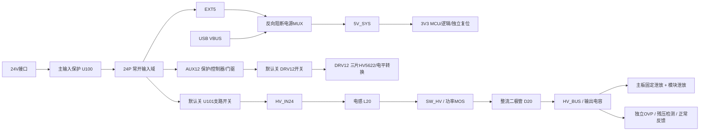

# Round 1 — QS30-9 高压安全行为基线

日期：2026-11-17。角色 A：系统架构。本文定义需要由硬件实现和证实的行为契约；它不是器件级电气资格、原生 EDA 工程或功能安全认证。制造 HOLD。24V-07 未通过，24V-08 未进入，完整 24V-09 未通过。受限低压模型只验证契约中的逻辑推论。

## 依据与历史边界

完整阅读 S05_CIRCUIT_CANDIDATES.md、config/sprint05.json、config/sprint06.json、SPRINT06C_REPORT.md、S06C_INTERFACE_CANDIDATES.md、SPRINT06F_REPORT.md；并阅读 S06D/S06E 的关键结果和剩余 Gate。S05 的 0.82Ω/UCC28C43、S06 的 UCC27511 及 S06C 的 LT3757A/62mΩ 是不同候选，不能混用采样、反馈或门驱模型。旧 12V 约0.79A锁存异常、不安全复位、错误 SW 电压采样、掉电行为保持历史 FAIL。S06F 的120µs真实采样结果未收敛；195V理想源会供能，不能作为实际HV系统。下述行为独立于最终 PWM 型号，接口映射须由器件角色明确选择候选变体。

## 先规定安全目标

1. 上电只建立低压控制域；硬件不依赖 MCU 程序即保持门驱禁止、支路关断和消隐。
2. 每一次新运行均需要供电与保护有效、独立人工 START 操作和有效的新请求事件；静态 GPIO 高电平不构成启动命令。发生故障、STOP、复位或任一关键电源丢失，撤销全部运行授权。
3. 故障撤销不能重新运行；复位只能回到未武装状态。故障优先于复位，STOP 优先于启动。
4. 物理执行器有两条：快速门驱禁止及独立24V支路开断。它们并不涵盖所有物理短路；两者共有检测/逻辑/电源也是共因风险，不能称为已实现冗余功能安全。
5. 输出储能是独立危险源。关闭 PWM 或支路只代表撤去命令，不代表电压为零。复位许可、维护许可和显示消隐使用不同的判据；60V/5s仅沿用工程设计指标，不是接触安全认证。

## 电源域及参考地



逻辑地与功率地仅在规定的 Kelvin 参考拓扑汇合；它们不是电气隔离域。U100的 RTN100 与 U101的 RTN101各为器件局部参考，设置/SHDN下拉只能返回自己的RTN，不能被USB、数字地、示波器地夹或其它 eFuse RTN短接。SHDN许可和FLT/IMON反馈均须逐路径隔离或有经验证的边界接口；只隔离SHDN却直连FLT不能修复RTN问题。保护输入及故障回传失电时不能凭开漏上拉把“不知道”读成健康。

## 硬件许可关系

符号全部表示经过供电有效、幅值/迟滞/延时资格化后的信号；未知、浮空和失电均按无许可处理。

```
BASE_OK = VIN24_OK & AUX_OK & LOGIC3_OK & TEMP_Q_OK & TEMP_L_OK
          & SENSOR_Q_VALID & SENSOR_L_VALID & INTERLOCK_OK & WATCHDOG_OK
          & MONITOR_VALID & !FAULT_LATCH
RESET_OK = BASE_OK_EXCEPT_LATCH & REQUEST_LOW & START_RELEASED & STOP_RELEASED
           & BRANCH_OFF_CONFIRMED & RESIDUAL_VALID & RESIDUAL_LOW
ARM = BASE_OK & MANUAL_START_FRESH & REQUEST_FRESH & REQUEST_LOW_SEEN_SINCE_RESET
DRV_PERMIT = BASE_OK & RUN_TOKEN
BRANCH_PERMIT = DRV_PERMIT & DRV_OK & PRECHARGE_PHASE_OR_LATER
PWM_PERMIT = BRANCH_PERMIT & PRECHARGE_DONE & START_LIMIT_OK & DEMAG_OR_MODE_OK
DISPLAY_PERMIT = PWM_PERMIT & HV_REG_STABLE & CHAIN_INITIALIZED & DISPLAY_REQUEST
```

RUN_TOKEN、fresh边沿、请求低已见、START释放与窗口看门狗必须是独立硬件门槛的候选要求，不能通过变量命名宣称已实现。手动START必须与MCU GPIO分离。简单RC高通不能单独证明新启动事件有效，慢电源斜率/掉电反弹需测试。单独 AND 门只实现组合许可，不能提供fresh请求、故障锁存或窗口看门狗。

DRV_PERMIT 不得依赖 DRV_OK，否则DRV12为0时永远无法建立。DRV未启用期间不把DRV_UV作为故障；启用后给定受限建立窗口，超时或建立后的掉压必须锁存。相同原则适用于预充及HV稳压资格，但 OVP、过流、温度、互锁和失电不设启动屏蔽。独立热保护监控在上电建立前无许可，不因传感器未稳定而启用HV。

窗口看门狗必须检测缺脉冲、静态高、静态低、过快和过慢；MCU硬件定时器在软件死机后仍运行的脉冲不能证明程序健康，应由安全任务完成挑战响应/受控服务。看门狗及人工事件电路未定型前，完整09保留HOLD。

## 时序和状态转移

下表的时间是必须建立的有界窗口，不是已经取得的器件保证。具体数值须由电容、斜率、门限和最坏传播值关闭后冻结；无界等待禁止进入后续状态。

|状态|DRV / 支路 / PWM / 显示|进入及退出条件|超时/异常行为|
|---|---|---|---|
|POWER_OFF|0 / 0 / 0 / 0|无有效24V；USB可能独立供逻辑|不承诺HV已无残压|
|LV_INIT|0 / 0 / 0 / 0|常开供电建立，POR清除令牌，MCU自检|任一未有效保持禁止|
|DISARMED|0 / 0 / 0 / 0|低压与保护健康；硬件见到请求低/START释放|任何静态高不进入ARM|
|DRV_START|1 / 0 / 0 / 0|新的人工启动+新请求，建立DRV12|DRV建立超时锁存|
|PRECHARGE|1 / 1 / 0 / 0|DRV健康后开支路；经L/D被动给输出充电|支路OC、预充超时/电压异常锁存|
|LIMITED_START|1 / 1 / 受限 / 0|预充完成；电流/脉冲/退磁策略有效|没有已资格启动策略则禁止实际进入|
|HV_VERIFY|1 / 1 / 受限 / 0|从0V连续启动后HV进入稳压范围|超时、失调、OVP锁存|
|RUN|1 / 1 / 1 / 1|164.9–175.1V稳压验证窗口完成，串行链清零/初始化|任一许可丢失立即消隐、撤门驱和支路|
|STOP_DISCHARGE|0 / 0 / 0 / 0|STOP或请求撤销；清令牌|残压持续过高不返回可启动状态|
|FAULT_LATCHED|0 / 0 / 0 / 0|严重故障置位；故障优先|故障消失保持锁存；按住复位不自动释放|
|RESET_QUALIFY|0 / 0 / 0 / 0|只接受复位新边沿且RESET_OK全部成立|任一条件失去回FAULT；成功回DISARMED|

建议逻辑模型可给出研究用DRV/预充/稳压窗口，但不以任意时间取代实物设计。上电总启动≤1s为既有系统需求；若各阶段资格证明无法满足，记录失败而非延长既有指标。启动接近Vin时Boost电感退磁不足，稳态DCM筛查无效。输出短路时输入经L/D继续供能，PWM禁止无法阻断此路径。预充仅由eFuse斜率产生不等于已完成受控预充，必须包含被动通路电流、L/D应力、输出上升/超时判据和输入电容SOA。

## 信号极性及失电缺省

|网络/语义|健康或允许|故障/无供电缺省|物理实现要求|
|---|---|---|---|
|*_OK / *_VALID|1|0|本地默认下拉；输出必须由有效偏置资格化|
|FAULT_LATCH|0|1（或POR强制未武装）|置位优先；失电不产生运行令牌|
|DRV_PERMIT|1|0|TPS22810 EN本地下拉，核查反向供电|
|BRANCH_PERMIT|1|0|隔离LED无电流；SHDN对本RTN下拉|
|PWM_PERMIT|1|0|硬件物理禁止，不只写COMP或软件占空比0|
|DRV_INHIBIT（UCC候选）|0|1|IN−本地上拉，健康许可才允许下拉|
|DISPLAY_PERMIT|1|0|BL极性按HV5622真值表核查，模块本地默认消隐|
|REQUEST|新有效边沿|0/静态高均无新授权|低已见+边沿资格；GPIO不直连执行器|
|MANUAL_RESET|新有效边沿|释放|按住不持续复位；故障置位优先|
|RESIDUAL_LOW|1且检测有效|0或未知|独立残压电路不能因无AUX而显示安全|
|BRANCH_OFF_CONFIRMED|HV_IN24低于定义阈值|0/未知|需输出侧电压测量，不能仅看SHDN命令|

“断电时FAULT_LATCH=1”是行为等价要求，不要求未供电逻辑输出物理高；物理无电时必须通过执行器本地偏置保持关断。完全断电会清易失锁存，因此恢复后POR进入DISARMED、需重新人工启动。若规格要求断电后仍显示原故障身份，需非易失/机械锁存补充，本轮未实现；不得把EEPROM固件记录用作硬件保护。

## 关断、残压和人工复位

检测到OVP、持续OC、热/传感器故障、互锁断开、看门狗或PG丢失：并行撤销PWM和支路，同时消隐并清除启动令牌。逐周期CS只终止本周期，不能替代持续OC锁存；反复进入限流须有独立持续故障判据。DRV12应撤销，但先行消隐以及掉电期间HV5622/电平转换的输出行为仍须器件级核查。

关断延迟预算必须从故障物理量越门限开始，包含分压/滤波/比较器/锁存/执行器和寄生，不从软件读到故障计时。OVP故障峰≤195V需要功率级dV/dt、剩余电感能量、输出最大电容/最小电容分别校核，不能只给一个比较器传播值。门驱执行级和输入开关各自时延独立记录；光耦不能充当逐周期限流。

残压监测独立于正常FB与OVP，采用独立取样点、上/下臂及有效性资格；共用HV_BUS与物理回路仍为共同失效。单个普通分压器上臂开路会谎报低压，因此“独立分压”本身不足以证明安全：应采用双监测一致性、测试注入/诊断或其它有可证明失效覆盖的方法；共地开路还须专门处理。低压未知、检测电源缺失或结果不一致均禁止复位及维护许可。复位阈值应低于沿用60V工程指标并留误差/迟滞余量；最终接触安全标准未定，不能标“可触摸”。

人工复位：请求低、START/STOP已释放、24V/AUX/3V3与监测器健康、温度降到复位带、传感器有效、互锁闭合、支路关断已确认、残压有效且低，且故障源已解除，才响应一次新复位边沿。复位不带出新的启动令牌；复位后必须重新人工START/新请求。支路失效导通若把HV_BUS持续充至约24V，残压虽可能低于60V，仍不能通过“低残压”豁免支路关断确认。

## Round 1 FMEA：单故障效果及边界

严重性 P0 表示在关闭之前禁止完整HV/制造；这里的“响应”是要求，不是已证明的性能。

|ID / 故障|局部/系统效应|检测与所需响应|双执行路径仍有的边界|当前证据/等级|
|---|---|---|---|---|
|F01 MOS逐周期过流|磁件饱和、MOS过流|真实源极Kelvin CS终止脉冲；持续限流另锁存|CS/MOS短路可能绕过采样；门驱禁止不能断物理短路|24V-07未通过；P0|
|F02 支路持续OC/输出短路|L/D被动直通、器件热应力|独立支路eFuse限流/锁存开断，撤门驱|eFuse失效导通时门驱对被动直通无效；源熔断I²t未证明|P0 HOLD|
|F03 HV过压|电容/驱动/绝缘超额定|独立OVP取样/基准/比较器，硬件锁存双撤销|OVP与FB共分压/同参考造成共因；输出剩余L能量继续充电|24V-09未通过；P0|
|F04 MOS过温|SOA降低、热失控|MOS贴合独立传感器，温窗硬件锁存|传感器贴合不良不一定被电断线诊断发现；不能当结温直接测量|P0 HOLD|
|F05 电感过温|L降低、绝缘/磁芯损坏|独立表面温感，低于最大100°C留时延/误差带|表温滞后与热态L(I,T)仍需验证|P0 HOLD|
|F06 温感开路/短路|可能谎报低温或极端温度|每通道双阈值有效窗；开路/短路均无许可并锁存|恰落正常阻值的部分短路不可检出；采样地/基准共因|P0 HOLD|
|F07 正常稳压FB断线|PWM饱和导致OVP；或停止稳压|独立OVP，不复用FB分压；HV_VERIFY超时|OVP链失效组合仍不安全；不能由启动超时防快速OVP|P0 HOLD|
|F08 MCU死机/重启/GPIO卡高|请求保持、输出失控|窗口看门狗/复位硬件清令牌；必须低已见/新请求/人工启动|单个看门狗服务任务也可能被错误固件维持，不能覆盖全部软件故障|P0 HOLD|
|F09 AUX/DRV/3V3 UV/序异常|逻辑不确定、门驱输出异常|独立窗监控与POR资格；本地默认禁止；DRV分阶段建窗|开漏无偏置不能当健康；共同AUX失效须靠本地缺省|P0 HOLD|
|F10 外24V断开/恢复/反接|支路残留、RTN移动、反向电流|主eFuse反接保护，24V_OK清令牌，恢复只到DISARMED|SHDN/FLT/USB若短RTN会破坏保护；主eFuse失效导通需源限制|P0 HOLD|
|F11 泄放开路|HV长时存储|主板固定分立泄放+单开路回归；残压低必须独立确认|只看5s计时不能证明放电；模块拆除减少泄放；全部失效需保持警示|24V-10未通过；P0|
|F12 HV支路开关失效导通|禁止状态HV_IN24仍有24V，被动充到输出|关断确认电压监测锁存；门驱仍禁止；必要上游总输入切断候选|24V被动路径仍存在；单门驱关断无电气隔离功能|P0 HOLD|
|F13 功率MOS D-S短路|24V→L→MOS→采样电阻持续直流|支路eFuse开断；主输入保护/熔断层级配合|门极禁止完全无效；源限流可能不足熔断，不能称两通路真正冗余|P0 HOLD|
|F14 HV驱动模块拔出/互锁断线|暴露带电端、泄放改变、逻辑不确定|带编码/有效窗的常闭回路断线立即消隐双关断，锁存|互锁触点短接不能由简单常闭检测；物理插拔先后/端子防触须审|P0 HOLD|
|F15 USB独供/低压反灌|AUX或DRV被GPIO抬升、伪PG、RTN破坏|USB仅供逻辑；目的域供电缓冲/反向阻断，逐脚失电验证|电源MUX不阻断数据/GPIO/ESD钳位回路；USB地不是隔离地|P0 HOLD|

有限双故障应至少覆盖：F12+F13（支路卡通+MOS短路）、F12+F02（卡通+输出短路）、F07+OVP分压开路、泄放开路+残压上臂开路、AUX掉电+GPIO卡高、USB供电+输入反接、互锁短接+拔模块。这些并非全部可容错，测试应暴露不能切断/不能检测的危险并保持HOLD，而非给模型增加万能FAULT信号使其通过。

## 24V-10 泄放与储能计划

Cmax暂按20µF×1.05+0.3µF=21.3µF；195V时能量约0.405J。按既有主板/三个模块共四支200kΩ泄放且+1%角点：全连等效50.5k，降到60V约1.267s；单支开路等效67.333k，约1.690s；仅主板一支202k约5.071s，已略超过5s指标。上述是理想RC计算，未含电容真实最高公差、泄放网络串联实体、温漂、漏电/反灌、接地断开；不能当通过。模块拆除状态必须重新预算，主板固定泄放不能依赖模块在位。若主板唯一支路开路，时间无上界；残压检测必须阻止重新许可。若要求主板单开路仍满足5s，需至少两条独立主板泄放路径，按任一完整支路开路重算并审功耗/耐压/失效短路。

为每个主板/模块组合登记：输出C最大/最小、初始195V、所有单泄放开路、任一串联电阻短路/开路、模块接地开路、检测参考地开路、输出二极管回灌、支路卡通、USB在/不在。保存从关断命令至电压真实穿越阈值的波形；阈值测量含检测误差/传播。必须先冻结接触安全标准和可访问性再设置对用户的安全指示；断电LED熄灭不等于低残压。

## 低压验证板与制造门槛

可以继续独立低压板设计。候选板须物理不装L20/Q20/D20及高压电容/管座/可接HV端子，以限流低压源注入检测端；外接源与测试夹具不得绕过RTN隔离。释放该板仍须关闭精确封装、逐针网络、供电/绝对最大值、默认禁止、测试点与故障注入能量审查；本报告不批准采购或下单。

完整QS30主板禁止投板：24V-07、08、完整09、10及原生ERC/DRC/高压间距/热/真实器件传播/单故障仍未合格。最小后续顺序：先实现电源有效资格与真实失电缺省→人工/请求/看门狗/置位优先锁存→双执行器及RTN隔离单元→独立OVP/温感/残压有效性→低压单元波形→既有07真实采样/热态问题→08从0V启动闭环→09真实HV故障峰/关断→10储能/机械/PCB评审。顺序依赖不阻止独立低压保护单元先行设计。
